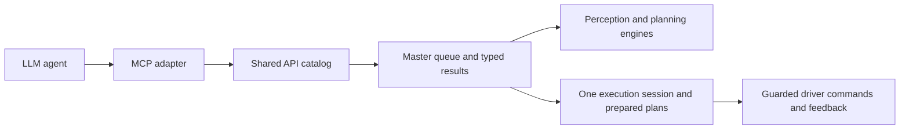

# Agent-controlled arm API design

Accepted design direction, 2026-10-13. Prepared-segment execution and queue
pause support are implemented as described in the implementation update below.
MCP transport and general TCP adjustment remain planned. Preserve the current
planners and execution checks.

## Decision

Expose useful task boundaries as public operations: observe, ground, segment,
calculate a grasp, plan motion, execute a prepared segment, open, close and lift.
The agent chooses tasks, parameters, adjustments and ordering. The master owns
execution state, source associations, feedback checks and object attachment.

Keep compound recipes as conveniences, built from the same operations used by
step-by-step control and benchmarking. Implement one operation once; MCP tools,
ROS clients, recipes and benchmarks all resolve it through
`task_pipeline/task_pipeline/registry.py` and the master runtime.

Internal waypoint interpolation, IK iterations, collision samples, feedback
polling, speed restoration and state bookkeeping remain inside operations.
These are observable through progress and metrics; the agent does not have to
issue a command for every sample or remember to update the held-object flag.

## What the repository already has

| Area | Current implementation | Design implication |
|---|---|---|
| Observation / perception | `capture_observation`, pins, `verify_presence`, `ground_object`, `segment_object` | Retain separate timed operations; presence and grounding remain separate inference requests. |
| Grasp planning | `prepare_grasp_input`, `calculate_grasps`, `select_grasp`, grasp cache APIs | Retain HGGD and validation; return references to source-linked results. |
| Motion planning | `prepare_held_scene`, `plan_final_approach`, `plan_motion`; `plan_placement` also supports lift-only requests | Retain engines. Add an explicit `plan_lift` public name/schema so lift is not presented as tray placement. |
| Prepared execution | `PreparedGraspLiftExecutor` holds one complete plan and executes it as one operation | Expose its prepared segments through the shared execution session. |
| Older staged execution | `GraspStages.phases/paths` and `HeldMotion.record` expose other grasp/lift stages | These are different state paths. Existing staged APIs cannot simply be advertised as aliases for the prepared executor. |
| General commands | `move_to`, `execute_trajectory`, `set_gripper` | Current general motion is empty-hand only; generic closing/release is restricted. Preserve these limits until payload-aware execution exists. |
| Offline handoff | `validate_prepared_grasp_lift` | Retain as a non-actuating readiness check; it does not test tracking/contact. |
| Scheduling | Master `StepStore`, result bindings, completion action, revisions and timings | Reuse; do not create an independent MCP queue/cache or planner sequence. |

## Proposed public surface

Names in this table describe the intended interface. New names and signatures
are defined in `my_actions` and the registry for implemented operations. The
implementation update below distinguishes these from future interfaces.

| Operation | Intended contract |
|---|---|
| `get_arm_state` / `get_execution_state` | Report feedback, attachment state, active task, plan revision, completed stages and available next stages. Extend current state reporting rather than returning joints alone. |
| Existing perception / grasp APIs | Return observation, object, mask and grasp result references; retain source timestamps, manual FK/X and explicit failures. |
| Existing planning APIs + proposed `plan_lift` | Return immutable validated plan segments with expected start/end state, waypoint counts, source/scene revisions and expiry. |
| `prepare_grasp_lift` | Retain convenience composition. Use the same planning operations and store one complete plan before any movement. |
| Proposed `execute_plan(plan_id, revision, segment)` | Execute `pregrasp`, `approach` or `lift`; optionally expose `near_grasp` and `final_grasp` when the planner provides validated boundaries. Return confirmed completion or explicit failure. |
| Proposed `gripper_open(width, force, plan_ref)` | Open with bounds and feedback confirmation. Planned grasp opening must match the prepared configuration; releasing a held object remains a validated release operation. |
| Proposed `gripper_close(force, plan_ref)` | Require the validated grasp endpoint; close and confirm contact, then update attachment state atomically. Closing without confirmed contact must not report the object held. |
| Existing `move_to(joints)` + proposed `move_tcp(pose)` | Plan/validate a target and execute through the same master owner. Payload motion requires a validated attachment and full applicable checks. |
| Proposed `adjust_tcp(delta_position, delta_rotation, frame, expected_revision)` | Provide bounded small adjustments in explicit base/tool coordinates, using manual FK. Validate a new plan; invalidate/replan affected remaining segments. Never mutate a cached path in place. |
| Task status / cancellation / stop | Read queue and stage progress; cancel at declared supported boundaries. An urgent stop uses the existing direct stop path and must not wait behind ordinary task work. |

`execute_plan` must consume planner-declared segment boundaries, not arbitrary
waypoint indexes supplied by an agent. The current near-grasp route does not
already provide a complete public checkpoint contract: storing boundary indices,
expected states and resumability rules is part of the implementation work.
An absent optional near-grasp returns an explicit unavailable/skipped result.

## Recommended grounding-to-lift sequence

Calculation, before any physical execution:

1. Capture/pin one synchronized observation.
2. Verify presence, then ground the requested bowl with a separate prompt.
3. Segment, prepare grasp inputs, calculate and select a validated HGGD grasp.
4. Register the object and preserve source-linked grasp results.
5. Prepare held geometry and calculate approach, lift and pre-grasp transfer.
   The existing preparation computes approach/lift before transfer; that need not
   match execution order. Validate all segments together and freeze the plan.
6. Inspect the prepared plan and check cached handoff readiness.

Physical continuation, once explicitly enabled:

7. `execute_plan(..., segment="pregrasp")` — includes speed/arrival checks.
8. `gripper_open(...)` — includes confirmed opening.
9. `execute_plan(..., segment="approach")` — includes reduced speed, optional
   near-grasp, final grasp and arrival checks. Separately selectable near/final
   stages remain bound to that same validated approach.
10. `gripper_close(...)` — includes confirmed contact and attachment transition.
11. `execute_plan(..., segment="lift")` — includes held-object tracking/contact
    checks, endpoint confirmation and appropriate speed restoration.

The agent may stop at a supported completed stage to inspect or request an
adjustment. Changes to pose, gripper configuration, attachment or obstacle scene
invalidate affected plans; the master reports the required replanning. Opening,
closing or movement out of order returns an explicit rejection.

## State and transport ownership

Replace independent authoritative phase records with one master-owned execution
session. It binds task/context, object, observation, scene and plan revision,
expected start state, attachment, expiry and execution phase. Engine-local
bounded immutable observation/geometry buffers may remain.

Suggested phases: `MOTION_READY -> AT_PREGRASP -> GRIPPER_OPEN -> AT_GRASP ->
CONTACT_CONFIRMED -> LIFTED`. Add `AT_NEAR_GRASP` only for a plan that has that
checkpoint. Advance phases only on confirmed completion. A started operation
whose outcome is unknown enters `STATE_UNKNOWN`; no automatic actuator retry.
Idempotent request IDs return an earlier result instead of moving twice.

MCP is a thin adapter with typed tools and task/result handles. Keep images,
clouds and trajectories in bounded ROS-side storage; use result references so
large data does not travel through the LLM or get copied for each API call.
Resolve only catalogued operations; never accept an arbitrary backend endpoint.
Annotate tool metadata with preconditions, side effects, completion/cancellation
semantics and whether hardware execution is allowed. No second solver/state
implementation belongs in the MCP server.

Use services for short reads/calculations where appropriate and completion jobs
or ROS actions for long operations. Current service calls cannot cancel an
in-flight backend; document this until cooperative execution cancellation is
implemented. Interrupts must be acknowledged at actual supported checkpoints;
resumption requires fresh state/revision validation.

## Implementation order for a later task

1. Define typed plan references, segment/checkpoint metadata, state transitions
   and API catalog entries; explicitly separate existing and proposed contracts.
2. Unify prepared, staged and held execution on one session and shared validators.
3. Expose segment execution and gripper APIs. Retain the complete executor as a
   recipe over those same operations, not a separate implementation.
4. Add validated TCP movement/adjustment and task inspection/cancellation.
5. Add MCP bindings from the shared catalog, returning small typed results/jobs.
6. Run the same mock/deployment recipes and benchmarks against those operations.
   Verify ordering, stale revisions, altered start state, contact uncertainty,
   cancellation and no duplicate actuator execution before hardware validation.

Trace each task/API/segment with correlated IDs and separate request overhead,
planning work, execution/feedback waiting and response time. Parent composite
timings include their children; do not add overlapping scopes. Mock replay tests
planning and handoff, not physical actuator tracking, contact or grasp success.
Do not change solvers, calibration, collision policies or physical gates as part
of this architectural refactor unless the user separately requests that change.

Implementation update (2026-10-13): the prepared-session `execute_plan`,
`gripper_open`, `gripper_close`, `get_execution_state` and lift-only `plan_lift`
APIs are now implemented. The standard grasp/lift recipe constructs all five
physical stages, and `--queue-grasp-lift` runs the calculation prefix then pauses
with those stages retained in the master queue. Near/final approach waypoints
remain one validated segment. General TCP adjustment, MCP transport and
held-object placement/release unification remain planned, not implemented.
See STANDARD_PIPELINE_API.md for phase and pause semantics.

Implementation update (2026-10-17): `prepare_pick_place`, its getter/readiness
check, and `--queue-pick-place` now cover the full prepared path through transfer,
descent and release using the same master-owned session. The queue pauses before
pregrasp and retains all nine execution/commit tasks. Existing staged APIs remain
compatibility paths; MCP transport and general TCP adjustment are still planned.
