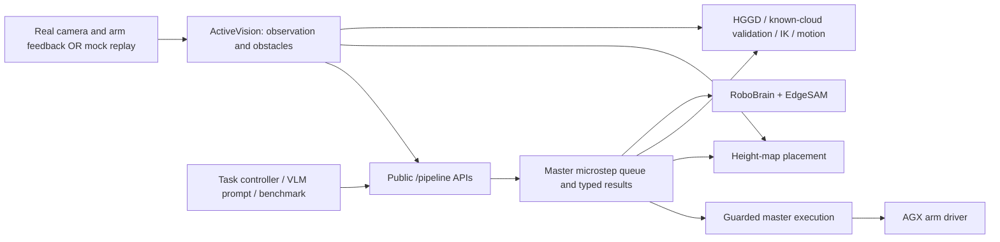

# Launched stack: nodes, files and API ownership

This guide covers the ROS nodes used for arm control, recorded-scene replay and
planning benchmarks. It does not inventory vendored libraries or every file.
Start with the [README launch walkthrough](../README.md).

## Runtime ownership



`task_pipeline/registry.py` defines public names, ROS types and native endpoints.
`pipeline_node` dispatches calls; `MasterStepRuntime` hosts the queue/results
inside `PiperMasterControl`. Numerical engines still own their observations,
geometry and numerical work. “Central state” does not mean replacing every
engine's bounded frame buffer with a single global buffer.

## What each launch starts

| Launch | Processes/nodes | Purpose |
|---|---|---|
| `master_node/reasoning_stack.launch.py` | `robot_core_container` with `active_vision_server` and `vamp_planner_server`; standalone `vlm_reasoning_node`, `piper_master_control`, `placement_node`; `pipeline_node` hosted inside the master process | Official production/planning stack; no camera or CAN driver is started |
| `mock_hardware_node/mock_hardware.launch.py` | `mock_hardware` | Replays recorded RGB-D and feedback on driver topic names |
| `placement_node/box_benchmark.launch.py` | `box_benchmark` | Adds synthetic box clouds and calculates sequential edge/stack placements |
| `vamp_node/grasp_debug_rviz.launch.py` | `grasp_debug_rviz` | Opens RViz with the installed grasp/placement configuration |
| `orbbec_camera/gemini_330_series.launch.py` | Orbbec camera driver | Real RGB/depth/intrinsics input |
| `agx_arm_ctrl/start_single_agx_arm.launch.py` | AGX arm controller | Real CAN commands and joint/TCP/gripper feedback |

Run the mock instead of real drivers. The benchmark is an additional controller,
not a replacement for the reasoning stack. RViz displays published results and
does not trigger calculation. `MasterStepRuntime`, `ExecutionAPI` and
`GraspStages` are classes in the master process, not separate launched nodes.

## Focused file hierarchy

```text
src/
├── master_node/
│   ├── launch/reasoning_stack.launch.py       official launch and parameter wiring
│   ├── config/inference/profiles.yaml        LM Studio / remote-server defaults
│   ├── config/calibration/hand_eye_calibration.yaml
│   └── master_node/
│       ├── piper_master_control.py           master node, legacy tasks, feedback, execution
│       ├── step_runtime.py                  master service/action host and engine dispatch
│       ├── execution_api.py                 arm state, selection/cache, general execution APIs
│       ├── grasp_stages.py                  ordered refinement/approach/gripper stages
│       └── world_state.py                   tracked objects and legacy task state
├── task_pipeline/
│   ├── scripts/pipeline_node                dispatcher entrypoint
│   ├── scripts/pipeline_task                calculation recipe CLI; waits for completion
│   └── task_pipeline/
│       ├── registry.py                      authoritative function/type/backend catalog
│       ├── node.py                          /pipeline services, capture, catalog, metrics
│       ├── context.py                       StepStore: typed results, bindings, revisions, queue
│       ├── recipes.py                       declared cup-to-tray calculation steps
│       ├── placement.py                     common batching and motion-failure retry policy
│       ├── timing.py                        shared PipelineTiming publisher helper
│       └── metrics.py                       function timing aggregation by mode/scope
├── my_actions/
│   ├── msg/PipelineStep.msg                 typed request envelope and dependency bindings
│   ├── msg/StepBinding.msg                  predecessor/field references
│   ├── msg/PipelineStepResult.msg           completion/status/timing/typed response
│   ├── msg/PipelineTiming.msg               API/engine timing samples
│   ├── msg/GraspCandidate.msg               validated grasp, contacts and joints
│   ├── msg/PlacementCandidate.msg           object placement pose and score
│   ├── action/RunPipelineSteps.action       queued completion, feedback, cancellation
│   └── srv/                                shared service schemas; mappings below
├── vision_node/
│   └── src/active_vision_server.cpp         RGB-D/feedback association, manual FK, obstacles
├── vlm_node/
│   ├── src/vlm_reasoning_node.cpp           HTTP inference, image APIs, legacy prompt controller
│   ├── src/edge_sam_onnx.cpp                segmentation encoder/decoder
│   └── include/vlm_node/
│       ├── grounding.hpp                   grounding prompt and strict box parsing
│       └── layout_prompt.hpp               multi-object template parsing
├── vamp_node/
│   ├── src/vamp_planner_server.cpp          grasp/IK/collision/motion/placement service engine
│   ├── src/hggd_mcu_adapter.cpp             HGGD AnchorNet/LocalNet proposals
│   ├── src/local_grasp_refiner.cpp          close-up contact geometry refinement
│   ├── src/known_cloud_grasp_generator.cpp  internal geometric known-cloud proposals
│   ├── include/vamp_node/
│   │   ├── deterministic_ik.hpp            current numerical IK and stagnation guard
│   │   ├── grasp_proposal.hpp              internal proposal representation
│   │   ├── payload_checked_robot.hpp       held-object collision adapter for VAMP
│   │   ├── placement_geometry.hpp          attachment/support/collision helpers
│   │   ├── organized_xyz_reader.hpp        per-scan XYZ offsets, unchanged point validity
│   │   ├── layout_scene_cache.hpp          exact frozen-scene geometry reuse
│   │   ├── placement_point_index.hpp       exact-point spatial collision lookup
│   │   ├── placement_ranking.hpp           placement candidate ordering
│   │   └── pipeline_timing.hpp             request-local numerical profiling
│   ├── launch/grasp_debug_rviz.launch.py    RViz entrypoint
│   └── rviz/grasp_debug.rviz                displays and topic configuration
├── vamp_mvt/                               VAMP C++ library and generated Piper robot model
├── placement_node/
│   ├── scripts/placement_node              production placement entrypoint
│   ├── scripts/box_benchmark               benchmark entrypoint
│   ├── scripts/benchmark_grounding         optional standalone HTTP latency tool
│   ├── launch/box_benchmark.launch.py       fixture/search/motion/output parameters
│   └── placement_node/
│       ├── node.py                         destination extraction, search/layout services, RViz
│       ├── packing.py                      deterministic height-map edge/stack search
│       ├── packing_api.py                  typed SearchPlacements transport adapters
│       ├── perception.py                   cloud/mask/support extraction and box parsing
│       ├── transforms.py                   manual-transform/attachment geometry helpers
│       ├── inference.py                    candidate model and optional AnyPlace adapter
│       ├── model.py                        optional AnyPlace network; inactive by default
│       ├── box_benchmark.py                fixture controller, shared API calls, reports
│       ├── box_fixture.py                  box surfaces, contact seeds and known floor patch
│       └── grounding.py                    request builder for standalone grounding utility
├── mock_hardware_node/
│   ├── launch/mock_hardware.launch.py       snapshot/prefix/conflict options
│   ├── mock_hardware_node/mock_hardware.py  replay node; fresh stamps, publisher conflicts
│   ├── mock_hardware_node/capture_snapshot.py  capture utility for replacement fixtures
│   ├── mock_hardware_node/snapshot_io.py    topic/type/file catalog and CDR I/O
│   └── snapshots/current/                  seven CDR messages + manifest replay fixture
├── agx_arm_ros/src/agx_arm_ctrl/            real arm-driver launch and CAN controller
└── OrbbecSDK_ROS2/orbbec_camera/            real camera-driver launch and RGB-D publication
```

Each package's `CMakeLists.txt` or `setup.py`/`package.xml` installs its entrypoints,
launch/config/assets and declares dependencies. `test/` contains regression checks;
these files are reusable source, not generated runtime output. `models/` assets
stay with their owning engine. `build/`, `install/` and `log/` are generated.

## Public function → schema → implementation

All names below have the prefix `/pipeline/`. The complete current catalog is
returned by `list_functions` (`my_actions/srv/GetPipelineFunctions`). Backend
names such as `/placement/*` are the numerical engine endpoints.

| Public functions | ROS schema(s), under `my_actions` | Owner |
|---|---|---|
| `run_step`, `submit_steps`, `store_step_result`, `get_step_context`, `clear_step_context`, action `run_steps` | `RunPipelineStep`, `SubmitPipelineSteps`, `StorePipelineResult`, `GetStepContext`, `ClearStepContext`, action `RunPipelineSteps` | `master_node/step_runtime.py` with `task_pipeline/context.py` |
| `capture_observation` | `CaptureObservation` | `task_pipeline/node.py`, consuming ActiveVision image/cloud/manual-transform topics |
| `verify_presence`, `ground_object`, `infer_vision`, `segment_object` | `VerifyPresence`, `GroundObject`, `VisionInference`, `SegmentGroundedImage` | `vlm_reasoning_node.cpp`; EdgeSAM implementation for segmentation |
| `prepare_grasp_input`, `select_grasp`, `cache_grasp_plan`, `get_cached_grasp` | `PrepareGraspInput`, `SelectGrasp`, `CacheGraspPlan`, `GetCachedGrasp` | `master_node/execution_api.py` |
| `calculate_grasps`, `calculate_cloud_grasps` | `FindGraspCandidates`, `FindCloudGrasps` | `vamp_planner_server.cpp`; HGGD RGB-D proposals or benchmark-provided known-cloud contacts |
| `refine_grasp`, `plan_final_approach` | `RefineGrasp`, `PlanCartesianGraspApproach` | `vamp_planner_server.cpp` and `local_grasp_refiner.cpp` |
| `cache_grasp_refinement`, `move_pregrasp`, `plan_grasp_approach`, `open_grasp_gripper`, `execute_grasp_approach`, `close_grasp_gripper`, `verify_grasp_contact` | `CacheGraspRefinement`, `GraspStage` | `master_node/grasp_stages.py`; validated state/order and guarded execution |
| `find_placements`, `search_placements`, `plan_layout` | `FindPlacementCandidates`, `SearchPlacements`, `PlanObjectLayout` | `placement_node/node.py`; `packing.py` is the default engine |
| `validate_placements`, `plan_placement` | `PlanPlacement` | shared policy in `task_pipeline/placement.py`, hosted by `step_runtime.py`; numerical backend in `vamp_planner_server.cpp` |
| `solve_pose`, `plan_motion` | `LookAt`, `CheckAndReplan` | `vamp_planner_server.cpp` using the existing IK and VAMP engines |
| `get_arm_state`, `move_to`, `execute_trajectory`, `set_gripper` | `GetArmState`, `MoveTo`, `ExecuteTrajectory`, `GripperCommand` | `master_node/execution_api.py` and existing master execution methods |
| `update_object`, `resolve_object`, `get_world_state` | `UpdateObjectObservation`, `ResolveObject`, `GetWorldState` | `piper_master_control.py` and `world_state.py` |
| `pin_grasp_observation`, `pin_placement_observation` | `PinLayoutObservation` | VAMP and placement engine frame caches respectively |

`get_metrics` uses `GetPipelineMetrics`. `/pipeline/timings` publishes
`PipelineTiming`. The registry also exposes retained navigation/recovery and
legacy task APIs. `execute_grasp`, `plan_layout` and `look_at_target` are
compatibility facades, not atomic numerical operations. Queue-control calls
cannot themselves be embedded recursively as executable microsteps.

## Which path a controller chooses

| Controller/input | Shared calculations | What differs |
|---|---|---|
| `pipeline_task` on a cup | capture, grounding, segmentation, HGGD/IK/collision, selection/cache, destination search, placement validation | Declarative 14-step recipe; legacy pose-only placement; no physical commands |
| VLM `/vlm_reasoning_node/chat_prompt` | same registered engine APIs and master cache | Parses templates, refreshes object state, builds the task sequence; retains existing command interfaces |
| `box_benchmark` | capture, tray grounding/segmentation, cloud-grasp validation, placement search/validation and full-motion planning | Known synthetic object geometry skips object RGB/HGGD; controller builds virtual scenes and commits accepted clouds |
| Physical grasp stages | validated cache, refinement, Cartesian approach, gripper command/contact verification | Require the physical gate and measured state; mock replay does not validate hardware execution |

Grasp/placement proposals are not physical execution. `PlanPlacement` with
`plan_pick_place_motion=true` requires valid lift/transfer/descent paths; false
retains legacy pose-only behavior. General execution APIs reject held-object
motion/release pending a validated placement execution implementation.

## Topics to inspect

| Purpose | Topic(s) |
|---|---|
| Driver/mock inputs | `/camera/color/image_raw`, `/camera/depth_registered/points`, `/camera/color/camera_info`, `/feedback/joint_states`, `/feedback/tcp_pose`, `/feedback/gripper_status`, `/feedback/arm_status` |
| Frozen manual observation | `/active_vision/observation_image`, `/active_vision/observation_cloud`, `/active_vision/observation_camera_transform` |
| Environment | `/active_vision/global_map`; used for collision context |
| Grasp result/debug | `/vamp_planner/segmented_target_cloud`, `/vamp_planner/grasp_candidates_markers`, `/vamp_planner/hggd_heatmap`, `/vamp_planner/refined_grasp_debug` |
| Ordinary placement | `/placement/destination_cloud`, `/placement/placement_candidates`, `/vamp_planner/refined_placed_object_cloud`, `/vamp_planner/placement_plan_markers` |
| Benchmark | `/box_benchmark/tray_cloud`, `/box_benchmark/boxes_cloud`, `/box_benchmark/placements`, `/box_benchmark/status` |
| Metrics | `/pipeline/timings` |
| Physical commands | `/control/joint_states`; published only by guarded master execution paths |

Benchmark visualization can show boxes only while collision calculation retains
surrounding obstacles. Its fused scene is available on `/box_benchmark/fused_cloud`.
An empty ordinary destination display does not imply benchmark tray grounding
failed: the two workflows publish different destination topics.

## Transform and execution rules

Perception and grasp computation use ActiveVision's manual
`FK(joints) * hand_eye_transform`, associated with the source observation.
Do not introduce computational TF fallbacks. Visualization-only TF is permitted.
The current acquisition implementation handles differing device clock domains
with local arrival association and a bounded RGB receipt-age fallback; this
is acquisition behavior to review on real hardware, not proof of strict original
header-time synchronization.

Physical grasp keeps measured pre-grasp validation, fixed-orientation 1–2 mm
Cartesian waypoints, joint continuity and detailed swept-volume collision tests.
The opening is `min(0.10, refined_width + 0.01)`; final approach uses 5% speed,
closing uses 0 m / 1 N only after the final waypoint, and speed is restored to
20%. Contact is verified from feedback, not inferred from a command.
Emergency stop and drivers retain direct control paths. See [AGENTS.md](../AGENTS.md)
for contributor invariants and [the API guide](STANDARD_PIPELINE_API.md) for
failure, timeout, result-store and cancellation semantics.

API performance support: `task_pipeline/api_metrics.py` correlates client/server
request and response phases; `my_actions/msg/ApiCallTrace.msg` carries server
monotonic timestamps. `PrepareCloudScene.srv` registers reusable geometry;
`RunPipelineStep.srv` carries optional same-context result bindings. The exact
collision index and bounded geometric cache are in
`vamp_node/include/vamp_node/placement_point_index.hpp`. Cached geometry is
compared byte-for-byte; collision decisions and IK results are never cached.

Floor-slot placement: `placement_node/floor_slots.py` owns the ROS-independent
adaptive 6–12.5 cm square grid with rectangular remainder slots, largest-inscribed-rectangle decomposition,
legacy fixed-grid builder and footprint stencil matching; `packing.py` validates its
coarse placements with the existing heightmaps. `placement_node/node.py` owns
bounded grid/reservation storage and `/placement/floor_slots` visualization.
`my_actions/srv/CommitFloorSlots.srv` defines the commit/reset contract;
`task_pipeline/registry.py` declares `commit_floor_slots`, and `recipes.py` appends
it after successful grid placement validation.


Payload execution is owned by `master_node/master_node/held_motion.py`: preparation
calls registered geometry/VAMP APIs, while four revision-bound stage services
execute lift, transfer, descent and confirmed release. Geometry preparation is
`placement_node/placement_node/held_scene.py`; its input semantic mask limits
source seam recovery so neighboring objects stay blocking. Schemas are
`PrepareHeldScene.srv`, `PrepareHeldMotion.srv`, `HeldMotionStage.srv`, with
source cloud/masks cached through `CacheGraspPlan.srv`. The physical lift-only
recipe lives in `task_pipeline/task_pipeline/recipes.py` (`grasp_and_lift`) and
is invoked by `pipeline_task --execute-grasp-lift`. It never places or releases.


`master_node/master_node/prepared_grasp_lift.py` owns the complete-plan physical
trial. `prepare_grasp_lift` calls registered geometry, final-approach, lift and
pre-grasp planning APIs before any command; `get_prepared_grasp_lift` checks
readiness and `execute_prepared_grasp_lift` follows cached trajectories only.
The two CLI recipes are in `task_pipeline/recipes.py`; `PreparedGraspLift.srv`
returns the revision used by the existing `HeldMotionStage.srv` execution request.

Prepared-stage APIs share `master_node/prepared_grasp_lift.py`: `execute_plan`,
`gripper_open`, `gripper_close`, `get_execution_state`, and the `plan_lift`
adapter. Their typed interfaces are `ExecutePlan.srv`,
`PreparedGripperCommand.srv`, `GetExecutionState.srv` and `PlanPlacement.srv`.
`task_pipeline/recipes.py` constructs the ordered tasks; `context.py` retains
pending tasks at an explicit `RunPipelineSteps` pause boundary. The
`pipeline_task --queue-grasp-lift` CLI reports that actual queue.

- `vamp_node/src/collision_spheres_viewer.cpp`: read-only live VAMP sphere FK,
  MarkerArray output with indices and measured gripper aperture.
- `vamp_node/launch/grasp_debug_rviz.launch.py` and
  `rviz/grasp_debug.rviz`: standalone sphere inspection view.

### Manipulation memory ownership

- `master_node/master_node/manipulation_memory.py`: bounded name/location hints,
  active RGB-D/object geometry, verified destination reuse, grid metadata and
  quick calculation retries. Coordinates are in `base_link`, metres.
- `my_actions/srv/ResolveManipulationTarget.srv`: typed resolution/refresh/read/
  forget requests; current observation and original mapped geometry provenance.
- `my_actions/srv/GetManipulationMemory.srv`: small metadata and task-list JSON.
- `task_pipeline/task_pipeline/registry.py`: all public memory/retry API names;
  `recipes.py:with_active_memory` connects default CLI sequences to them.
- `placement_node/placement_node/node.py`: owns actual grid/reservations; exposes
  read-only `get_floor_slots` and uses verified frozen destination geometry.
- `vlm_node/src/vlm_reasoning_node.cpp`: resolves targets through the shared
  memory APIs. It does not own a second long-lived geometry directory.

- `master_node/master_node/prepared_plan_review.py`: final-only RViz markers and
  requested/achieved object clouds for the master-owned prepared session. It
  consumes accepted backend geometry, performs visualization transforms only,
  and never invokes a planner or actuator.

### Next-best-view ownership

- `vision_node/include/vision_node/nbv_preference.hpp`: top-down/base-facing sample generation and ranking; ActiveVision retains octree visibility checks.
- `my_actions/srv/PlanNextBestView.srv`: named/explicit target, desired range and revision-bound planned camera/TCP/path result.
- `master_node/master_node/next_best_view.py`: master-owned view cache, shared capture/IK/VAMP calls and guarded empty-hand execution.
- `task_pipeline/task_pipeline/registry.py`: public plan_next_best_view / execute_next_best_view catalog entries.
- `task_pipeline/task_pipeline/recipes.py`: owner-bound look/payload/clearance plans; queue pauses before look, then post-release withdrawal, clearance and capture.

- `my_actions/srv/PlanCameraRetreat.srv` and VAMP `handlePlanCameraRetreat`: frozen predicted scene, released start/open jaw, full-scene clearance-only mode or explicit view candidates, validated retreat path/FK endpoint.

- `plan_lift` / `PlanPlacement.empty_hand`: VAMP handleEmptyHandLift validates a released-gripper lift without attaching the placed object.
- `vamp_node/include/vamp_node/empty_hand_withdrawal.hpp`: bounded initial released-object finger contact policy; separate from held-object noise allowance.
- `execute_withdrawal` / master prepared session: ordered cached empty-hand segment between release and clearance retreat, with its own RViz endpoint.

### Target visibility API

- `my_actions/srv/CheckTargetView.srv`: public memory/name-based visibility decision.
- `my_actions/srv/CheckTargetVisibility.srv`: frozen geometry/camera backend schema.
- `master_node/master_node/target_view.py`: read-only active/directory lookup and
  shared capture/backend dispatch; registered by `manipulation_memory.py`.
- `vision_node/include/vision_node/target_visibility.hpp`: field of view, range,
  target-cell exclusion and bounded OctoMap ray checks; served by
  `active_vision_server.cpp` on `/active_vision/check_target_visibility`.
- `task_pipeline/task_pipeline/registry.py`: canonical public endpoints for both
  visibility functions; existing request/response tracing applies.


### Persistent destination map

- `master_node/master_node/destination_memory.py`: confirmed-release transform,
  idempotent object-cloud merge, bounded capacity and explicit mapped inputs.
- `manipulation_memory.py`: retains immutable tray base and composite destination
  across view changes; clears on destination switch/explicit forget.
- `placement_node/placement_node/held_scene.py`: reconstructs frozen support and
  obstacle inputs from current observation plus remembered destination geometry.
- `placement_node/placement_node/node.py`: uses immutable base for grid cache keys
  while merged destination points block later placements. Slot commits preserve
  whole-cell exclusivity and existing IDs.

- `vamp_node/include/vamp_node/guided_joint_lift.hpp`: bounded differential
  joint ascent with object-up/height tasks, free XY/yaw, APF and joint-margin
  guidance, active joint-bound handling and validated dense edges. Called by the
  shared held-motion planner before Cartesian fallbacks. It is not used by the
  final grasp approach or post-release withdrawal.

### All-target perception inventory

- `my_actions/srv/PerceiveScene.srv`: shared target-list / synchronized-capture input and per-target visibility, position and status output.
- `master_node/master_node/scene_perception.py`: batch presence and bounding-box inference, strict parsing, per-target EdgeSAM, and shared memory updates.
- `master_node/config/perception/scene_targets.yaml`: default requested inventory, independent of the active pick object.
- `task_pipeline/task_pipeline/recipes.py`: one inventory pass before grasp calculation; object/destination reads use `get_active_target` afterward.
- `task_pipeline/task_pipeline/mock_bowl_cup.py`: same all-target API for initial benchmark perception.
