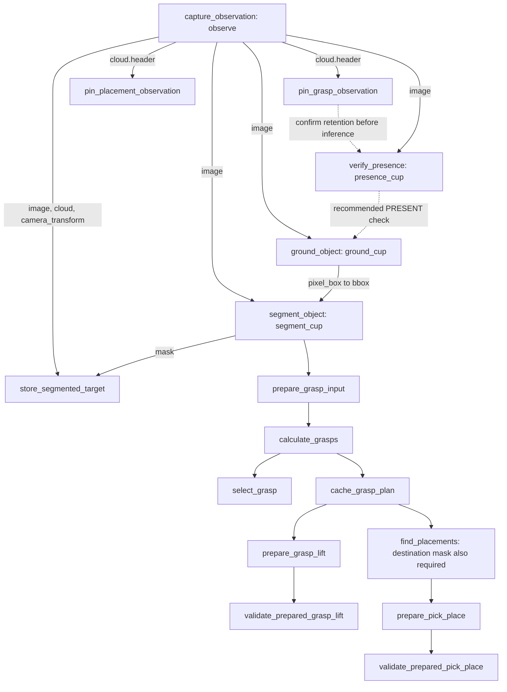

## Scene-perception shortcut (3.5.0)

Use get_workflow_example with workflow=perceive_scene for a schema-checked
two-call example. Initial capture uses context_id=""; the next input uses
its returned result.structuredContent.context_id. Bind image <- capture.image,
observation_cloud <- capture.cloud, camera_transform <- capture.camera_transform
in that same context. New operations use new request/step IDs. A full supplied
triplet avoids implicit recapture. SCENE_INFERENCE_UNKNOWN reports an untrusted
VLM answer, not a missing prerequisite or an absent object.

# Tool prerequisites, sequences and recovery — MCP 3.3.0

Read this resource as `ros-pipeline://tool-dependencies`. Read the generated JSON
at `ros-pipeline://tool-dependency-graph` for **every tool**, its labelled edges,
current availability, binding paths and complete reusable recipe examples.
`list_functions` and `ros-pipeline://catalog` include the same per-tool guidance
in `_meta.rosPipeline` and in the descriptions shown to the model.

This is discovery/documentation, not execution permission. No mode, allowlist,
physical gate, live-input guard, ownership check, ledger or retry rule is weakened.
A disabled tool cannot be fixed by calling more prerequisites. In preparation-only
mode, physical tools remain disabled even when all calculations succeed.

## Read the dependency fields

Each tool has:

- `prerequisites.prior_calls`: actual public tool names, relationship and reason.
- `prerequisites.bindings`: request `target_field`, producing `source_tool`, example
  `source_step_id`, ROS response `source_field`, and conditionality.
- `prerequisites.context_state`: source consistency, cache/session state and mode
  conditions. Reads do not populate missing memory or prepare motion.
- `execution_sequence`: recommended complete caller route. Its order is useful;
  it does not turn every recommended call into a mandatory backend gate.
- `example`: an inline request template with real field paths and step IDs.
  Standalone low-level solvers additionally need task-specific geometry/targets.
- `sequence_semantics`, `example_semantics`, `binding_semantics`: limits on how to
  interpret the examples. Never fill missing geometry with invented values.

Edges distinguish **required**, **recommended**, **conditional**, **alternative**,
**internal**, **state**, and **optional**. Alternative producers are alternatives,
not a requirement to call every producer. Read `availability` on graph nodes and
the actual server allowlist before choosing a route.

## Correct dataflow: ordering is different from binding



`ground_object` binds **image from capture**, not a boolean/response from
`verify_presence`. `segment_object` binds the **same image** plus `pixel_box` from
grounding. The destination follows its own presence/ground/segment calls against
the same observation; bind its mask to placement inputs, not the object's mask.

`resolve_target` is a compound alternative: it can reuse valid memory or internally
capture -> verify -> ground -> segment -> store. The caller does **not** have to
run all those APIs first. Supply `name`/`role`, then either omit the optional
observation triplet entirely for internal capture, or bind **all three** image,
cloud and camera transform from one capture. Supplying just an image fails source
association. `store_segmented_target` is the explicit mask-to-cloud route.

## Concrete step IDs and bindings

In these examples, the first call returns a real `context_id`. Replace
`RETURNED_CONTEXT_ID` with that value on later calls. IDs such as `observe` and
`ground_cup` are owner-chosen examples; if your IDs differ, change every referring
binding consistently. The tool name and `source_field` must remain exact.

Call `capture_observation`:

```json
{"context_id":"","step_id":"observe","request_id":"demo_capture_001","arguments":{},"bindings":[]}
```

Then call `verify_presence`:

```json
{"context_id":"RETURNED_CONTEXT_ID","step_id":"presence_cup","request_id":"demo_presence_001","arguments":{"target":"brown cup"},"bindings":[{"target_field":"image","source_step_id":"observe","source_field":"image"}]}
```

Require success and `present=true` for the recipe's presence decision, then call
`ground_object`:

```json
{"context_id":"RETURNED_CONTEXT_ID","step_id":"ground_cup","request_id":"demo_ground_001","arguments":{"target":"brown cup"},"bindings":[{"target_field":"image","source_step_id":"observe","source_field":"image"}]}
```

Then call `segment_object`:

```json
{"context_id":"RETURNED_CONTEXT_ID","step_id":"segment_cup","request_id":"demo_segment_001","arguments":{},"bindings":[{"target_field":"image","source_step_id":"observe","source_field":"image"},{"target_field":"bbox","source_step_id":"ground_cup","source_field":"pixel_box"}]}
```

To populate object memory, call `store_segmented_target`:

```json
{"context_id":"RETURNED_CONTEXT_ID","step_id":"remember_cup","request_id":"demo_store_001","arguments":{"name":"brown cup","role":"object"},"bindings":[{"target_field":"image","source_step_id":"observe","source_field":"image"},{"target_field":"mask","source_step_id":"segment_cup","source_field":"mask"},{"target_field":"observation_cloud","source_step_id":"observe","source_field":"cloud"},{"target_field":"camera_transform","source_step_id":"observe","source_field":"camera_transform"}]}
```

Use `role="destination"` and its own segmentation for destination memory.
`source_field` is **`image`**, not `output.image` or `response.image`. Those outer
wrappers are MCP projections, not ROS response fields. Do not paste image/cloud
buffers or CDR into arguments. `@response_cdr` is a typed server-side binding for
APIs whose declared input needs an entire earlier response, such as `look_plan_cdr`.

The graph's `examples.grasp_lift` and `examples.pick_place` contain complete request
sequences generated from the existing production recipes, including the remaining
seed, mask, pool, source header, placement and look-plan bindings. They are labelled
examples, not a claim that geometric planning always succeeds on every scene.
Use them as individual named calls. The final `get_execution_state` is a direct
read with `{"object_name":"brown cup"}`, not the preparation envelope.

Direct `get_arm_state` is another snapshot, not a stored StepStore result. Copy
its primitive joints into `arguments.current_joints` where needed. Do not invent
an `arm_state` step ID and attempt to bind it. For primitive values already
produced by a stored preparation, normal typed bindings remain supported.

## Cache/active-state mistakes and recovery

| Actual failure | Meaning and supported next step |
| --- | --- |
| `NO_PREPARED_GRASP_LIFT` | No usable record exists. Complete `cache_grasp_plan` -> `prepare_grasp_lift`, then get/validate it for the exact object. A failed/expired/invalidated record is not repaired by a getter. |
| `NO_PREPARED_PICK_PLACE` | Complete source/grasp/destination/slot preparation and successful `prepare_pick_place`, then get/validate the exact object record. |
| `NO_CACHED_GRASP` / `NO_FRESH_CACHED_GRASP` | Supply a valid grasp pool and source associations to `cache_grasp_plan`, then read/use that cache. |
| `ACTIVE_TARGET_REQUIRED` | Populate memory with the explicit capture/presence/ground/segment/store route, or use compound `resolve_target`; a memory getter does not create an active target. |
| `SYNCHRONIZED_IMAGE_AND_CLOUD_REQUIRED` | Bind the image/cloud/transform triplet from one capture, or omit all optional inputs on the compound route. |
| `DEPENDENCY_FAILED` / binding type/path errors | Inspect `get_step_context`; use the successful producer's actual step ID and an exact response field compatible with the target. |
| Provenance, stale feedback or physical-gate errors | Restore the required input/state or correct server mode locally; no alternative binding can bypass the guard. |
| `STATE_UNKNOWN` / unresolved timeout | Keep the receipt and ledger; do not replay, reset uncertainty or reprepare to bypass it. Local reconciliation is required. |

Failures gain an additive `recovery` object: missing prerequisites, execution
sequence, binding examples, context requirements and graph URI. Original
`status`, raw result, success/failure and durable receipt semantics remain intact.
Where a call supplies bindings, hints preserve the **actual submitted step IDs**.
A missing cache does not prove preparation was never called: expiry, invalidation
or a failed producer can give the same error. Already-failed dependent stages in
asynchronous `run_steps` results include their own recovery hints too.

MCP's SDK rejects malformed input schemas before the application handler. Those
errors retain the SDK's input-validation message; do not expect backend recovery
fields on a request that never reached the adapter. Generic `run_steps` start is
an acknowledgement: poll `operation="status"` with the same job request_id and
context until `FINAL_ACTION_RESULT`. Queue admission or RUNNING is not completion.

## Grasp-cache recovery: use actual fields, not inferred names

`NO_FRESH_CACHED_GRASP` does not prove grasp steps were never called. Read
`get_step_context` and inspect each producer's **success/status**, not just its
presence in the task history. A context can contain failed `prepare_grasp_input`,
`calculate_grasps`, `select_grasp` and `cache_grasp_plan` calls and still have no
usable cache. Keep the same owned context, but use new step/request IDs for a
corrected attempt. Reusing a failed ID retrieves its stored failure receipt.
Fetch the current revision; a quoted earlier revision may no longer be current.

| Proposed/inferred field | Actual API contract |
| --- | --- |
| `calculate_active_grasps.grasp_input` | Does not exist. Fresh active memory is required; this compound API internally pins the observation, prepares grasp inputs and calculates candidates. Set `target_description`; bindings can be empty. |
| `select_grasp.calculated_grasps` from output `grasps` | Bind request **`candidates`** from calculation response **`candidates`**. The selected response field is **`candidate`**, singular. |
| `cache_grasp_plan.selected_grasp` from output `grasp` | Does not exist. Bind **`candidates`** (prefer the validated whole pool), plus matching `observation_header`, `observation_cloud`, `source_mask` and `semantic_mask`. |
| `get_cached_grasp.cached_grasp_plan` from output `plan` | Neither field exists. Set literal **`object_name`** and use **`bindings: []`**. The preceding cache operation changes internal state and returns only success/status. |

There are two valid routes; do not mix their request contracts:

- **Explicit inputs:** capture/pin -> presence -> ground -> segment ->
  prepare_grasp_input -> calculate_grasps -> select_grasp -> cache_grasp_plan ->
  get_cached_grasp. `calculate_grasps` consumes individual seed/dimension/affordance
  fields from preparation, not a `grasp_input` message.
- **Active memory:** capture/presence/ground/segment/store (or compound
  resolve_target) -> calculate_active_grasps -> select_grasp -> cache_grasp_plan ->
  get_cached_grasp. There is no required separate prepare_grasp_input call on this
  route because calculate_active_grasps already performs it internally. Cache
  source geometry must match the active observation used by that calculation.

Examples of the last three calls after an explicit calculation named
`recovery_grasps`, using its capture `recovery_observe` and segmentation
`recovery_segment`:

```json
{"context_id":"RETURNED_CONTEXT_ID","step_id":"recovery_select","request_id":"recovery_select_unique","arguments":{},"bindings":[{"target_field":"candidates","source_step_id":"recovery_grasps","source_field":"candidates"}]}
```

```json
{"context_id":"RETURNED_CONTEXT_ID","step_id":"recovery_cache","request_id":"recovery_cache_unique","arguments":{"object_name":"brown cup","ttl_seconds":900},"bindings":[{"target_field":"candidates","source_step_id":"recovery_grasps","source_field":"candidates"},{"target_field":"observation_header","source_step_id":"recovery_observe","source_field":"cloud.header"},{"target_field":"observation_cloud","source_step_id":"recovery_observe","source_field":"cloud"},{"target_field":"source_mask","source_step_id":"recovery_grasps","source_field":"validated_target_mask"},{"target_field":"semantic_mask","source_step_id":"recovery_segment","source_field":"mask"}]}
```

```json
{"context_id":"RETURNED_CONTEXT_ID","step_id":"recovery_cache_check","request_id":"recovery_cache_check_unique","arguments":{"object_name":"brown cup"},"bindings":[]}
```

Use the actual exact object name and actual producer IDs. Do not create a fresh
context to bypass a failed/unknown task. When source data is stale or mismatched,
a new capture and perception chain can be stored under new IDs in the **same**
context. Stop on a presence, grounding, segmentation or geometry failure; do not
continue with empty/default inputs or treat visual uncertainty as absence.

Cache failures now include **proposed `recovery_steps`** generated from the real
production recipe with valid fields and same-context bindings. They are never
executed automatically. `observed_prerequisite_results` reports the actual
successful/failed producer history when context inspection is available, and
`observed_context_revision` identifies that snapshot. `valid_binding_targets` and
`response_fields` list the real top-level ROS fields. Invalid binding fields are
rejected before calculation dispatch with the relevant tool and valid field list.
The grasp cache defaults to 900 seconds (15 minutes), capped at 900 seconds.
A shorter explicit ttl_seconds is honored. Preparation and validation do not
consume it; admitted prepared execution removes it from public reuse and keeps
its immutable source privately for the active session.

## Observation cache errors: pinning and source identity

`OBSERVATION_NOT_IN_CACHE` means VAMP could not retrieve the requested registered
RGB-D frame. StepStore may still retain the image/mask result, so a successful
`prepare_grasp_input` does **not** guarantee that the separate rolling VAMP source
cache still contains the frame. This is not repaired by adding more seed fields.

For the explicit route, pin immediately after capturing, before VLM/agent delays:

```json
{"context_id":"RETURNED_CONTEXT_ID","step_id":"pin_source","request_id":"pin_source_unique","arguments":{},"bindings":[{"target_field":"observation_header","source_step_id":"capture_001","source_field":"cloud.header"}]}
```

Then use that one source consistently:

- prepare_grasp_input: capture image/header + that capture's segmentation and ground box.
- calculate_grasps: **the same capture header**, the same segmentation mask, and
  seed_u, seed_v, image_width, image_height, affordance_type from that preparation.
- Do not replace the header/mask with a later resolve_target response while
  retaining older prepared seeds. Same context does not mean same observation.
- If the source was already evicted, use new IDs for a fresh capture/pin/perception
  chain. Never edit timestamps or substitute the latest cloud for an old mask.

For active memory, the stored object name must be provided explicitly:

```json
{"context_id":"RETURNED_CONTEXT_ID","step_id":"active_grasps","request_id":"active_grasps_unique","arguments":{"target_description":"cup","affordance_type":"AUTO"},"bindings":[]}
```

Here `cup` must exactly identify the stored/resolved object name. An empty
`target_description` produces ACTIVE_OBJECT_REQUIRED even if a named cup record
exists; mask/header bindings do not select that record. MCP now requires a
nonempty target_description for this operation before backend dispatch.

A compact active route is **capture -> pin_grasp_observation -> resolve_target
with the complete captured image/cloud/transform triplet -> calculate_active_grasps
with the stored name**. Resolve supplies fresh active geometry; calculation
internally pins it again and prepares its own inputs. Do not externally combine
old prepare_grasp_input outputs with a newer resolve response. The existing
active-memory freshness checks and source/cache limits remain enforced.

## Instructions for the outside agent

1. Refresh discovery after reconnect/version changes; require actual tool availability.
2. Read this resource and the structured graph before composing a missing-state route.
3. Choose explicit perception or compound target resolution; do not run both blindly.
4. Reuse returned context IDs, real predecessor step IDs and exact field paths.
5. Require successful producers and preserve source/frame/revision association.
6. On failure, preserve its status/receipt and use `recovery`; do not auto-retry.
7. Never interpret a calculated/visible grasp as a complete placement plan or permission
   to dispatch motion. Preparation-only mode never permits arm/gripper execution.
